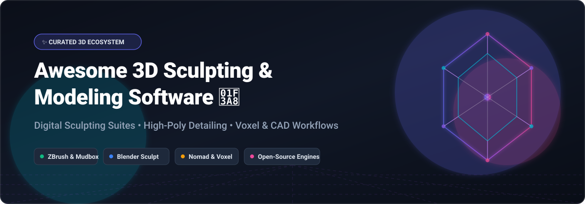

# Awesome 3D Sculpting & Modeling Software 🎨🗿

  <strong>Curated Directory of Digital Sculpting Suites, Voxel Modelers, 3D Mesh Editors, and Open-Source Computer Graphics Frameworks</strong>

  <em>High-poly sculpting, dynamic topology (Dyntopo), voxel remeshing, retopology, multi-resolution detailing, and texture painting for AAA games, VFX, 3D printing, and AR/VR workflows.</em>

  <strong>Last updated: October 2026 🚀</strong>

---

## 📑 Table of Contents

- [🌐 Sector Overview & Market Dynamics](#-sector-overview--market-dynamics)
- [💼 SaaS & Commercial Platforms](#-saas--commercial-platforms)
- [⚡ Open-Source GitHub Projects](#-open-source-github-projects)
- [🌟 Star History](#-star-history)
- [🤝 Support & Sponsoring](#-support--sponsoring)
- [✍️ How to Contribute](#️-how-to-contribute)
- [⚠️ Disclaimer](#️-disclaimer)

---

## 🌐 Sector Overview & Market Dynamics

The global **3D modeling and digital sculpting software market** is estimated at approximately **USD 8B–10B** (projected to surpass **USD 18B by the early 2030s**, expanding at a **~12–14% CAGR**), energized by surging demand across real-time game engines (Unreal Engine 5, Unity), film visual effects (VFX), spatial computing (Apple Vision Pro, Meta Quest), and rapid 3D prototyping.

The market structure is **moderately concentrated**:
- **Enterprise Heavyweights & Incumbents:** A consolidated tier of multi-billion dollar publicly listed giants—notably **Adobe** (Substance 3D ecosystem) and **Autodesk** (Maya, 3ds Max, Mudbox)—alongside specialized titans like **Maxon** (Nemetschek Group / ZBrush), holding high-friction workflows in AAA studios and visual arts.
- **Open-Source Powerhouse:** The community-led standard **Blender** commands colossal industry adoption across indie studios and enterprise pipelines alike, dismantling traditional subscription moats with native voxel sculpting, Dyntopo, and cycle rendering.
- **Dynamic Fragmentation:** Agile independent players are disrupting high-poly authoring niches—most notably **Nomad Sculpt** dominating the iPad Pro / Android mobile digital clay space, and browser-native WebGL apps providing immediate accessible tooling.

---

## 💼 SaaS & Commercial Platforms

The following table details leading hosted, subscription, and commercial 3D sculpting and modeling software suites, sorted in descending order by **Company Size / Valuation / Revenue**:

| Product 🏷️ | Description 📝 | Company Scale / Valuation 🏢 | Pricing (Starting Tier) 💳 | Free Tier Limit / Trial Duration ⏱️ |
| :--- | :--- | :--- | :--- | :--- |
| **[Adobe Substance 3D Modeler](https://www.adobe.com/products/substance3d/apps/modeler.html)** | Intuitive desktop & VR clay-sculpting application utilizing Signed Distance Fields (SDF) and gesture controls. | **~$220B–$240B Market Cap** (Adobe Inc., FY2024 Revenue ~$21.4B) | **$49.99/month** (or $599.88/year prepaid) for Substance 3D Collection; single-app plan from **$19.99/month** | **30-day free trial** of Substance 3D Collection (includes Modeler, Painter, Sampler, Designer, Stager, and 100 GB Cloud Storage; full export capabilities) |
| **[Autodesk Maya](https://www.autodesk.com/products/maya/)** | Studio-standard 3D modeling, rigging, simulation, and animation package with integrated surface sculpting brushes. | **~$55B–$65B Market Cap** (Autodesk Inc., FY2025 Revenue ~$5.5B–$6.0B) | **$235/month** or **$1,875/year** subscription (Autodesk Flex: $300 for 100 tokens, 6 tokens/day) | **30-day free trial** with full feature access; permanent free access via **Autodesk Education License** for verified students & educators |
| **[Autodesk Mudbox](https://www.autodesk.com/products/mudbox/)** | High-resolution digital sculpting and 3D texture painting software engineered for detailed organic characters. | **~$55B–$65B Market Cap** (Autodesk Inc., FY2025 Revenue ~$5.5B–$6.0B) | **$10/month** or **$100/year** subscription (or 2 Flex tokens/day) | **30-day free trial** with complete sculpting, multi-layer painting, and export functionality; no permanent free tier |
| **[ZBrush (Maxon)](https://www.maxon.net/en/zbrush)** | Gold-standard digital sculpting tool renowned for handling tens of millions of polygons with dynamesh and zremesher. | **~$10B–$12B Parent Market Cap** (Nemetschek Group / Maxon Computer GmbH; Maxon ARR ~$140M+) | **$39.00/month** (billed annually at $468.00/year) or **$49.00/month** (billed monthly) | **14-day free trial** of Maxon One / ZBrush with full high-poly sculpting and export features; bundled free version on iPad with basic sculpting brushes |
| **[3D-Coat](https://3dcoat.com/)** | All-in-one digital sculpting application with voxel sculpting, auto-retopology, UV unwrapping, and hand-painting. | **Privately held SME** (Pilgway, estimated $5M–$15M annual revenue) | **€20.75/month** (€249.00/year subscription) or **€379.00** node-locked perpetual license | **30-day unlimited free trial**; transitions post-trial into a **Learning Mode** (exports restricted to 20,000 triangles and 1 texture map of 2048x2048) |
| **[Nomad Sculpt](https://nomad-sculpt.com/)** | High-performance mobile sculpting application designed for stylus-based workflows on iOS, iPadOS, and Android. | **Bootstrapped Indie Studio** (HexMap / Stéphane Ginier, estimated $2M–$5M ARR) | **$19.99 one-time purchase** on Apple App Store; **$19.99 one-time in-app purchase** on Google Play | **Free trial mode on Android** (unlimited sculpting, baking, and rendering; project saving and OBJ/GLTF file export disabled until unlock) |

---

## ⚡ Open-Source GitHub Projects

Explore the finest open-source 3D sculpting suites, polygon modeling toolkits, retopology engines, and mesh-processing libraries. Sorted by **GitHub_Stars (Descending)**:

- ### 1. **[FreeCAD](https://github.com/FreeCAD/FreeCAD)**  🛠️
  *A general-purpose open-source parametric 3D CAD/CAM/CAE modeler.*
  - **Overview**: Geared towards mechanical engineering, product design, and architectural BIM workflows. Features a modular architecture with specialized workbenches for mesh design, surfacing, and CSG modeling.
  - **Best For**: Parametric base meshes and engineering-accurate solid modeling prior to artistic sculpting passes.
  - **License**: LGPL-2.1

- ### 2. **[Blender](https://github.com/blender/blender)**  🎨
  *The flagship open-source 3D creation suite: sculpting, modeling, rigging, animation, simulation, rendering, and compositing.*
  - **Sculpting Features**:
    - **Voxel Remeshing**: Rapidly rebuilds manifold geometry with uniform topology to block out concepts without pinching.
    - **Dynamic Topology (Dyntopo)**: Dynamically tessellates triangles under the brush tip for spontaneous organic carving.
    - **Multiresolution Modifier**: Industry-standard non-destructive multi-level subdivision surface sculpting and baking.
    - **Face Sets & Masking**: Granular localized control over dense high-poly meshes.
  - **Best For**: Artists and game developers seeking a production-ready, fully free, subscription-free studio standard.
  - **License**: GPL-3.0

- ### 3. **[AliceVision Meshroom](https://github.com/alicevision/Meshroom)**  📸
  *Open-source 3D photogrammetry and surface reconstruction software pipeline.*
  - **Overview**: Turns collections of photographs into dense, textured 3D meshes ready for digital clean-up, remeshing, and clay detailing.
  - **Best For**: Capturing real-world organic reference models, statues, and environmental scans for sculpting pipelines.
  - **License**: MPL-2.0

- ### 4. **[OpenSCAD](https://github.com/openscad/openscad)**  📐
  *The Programmers Solid 3D CAD Modeler.*
  - **Overview**: Instead of interactive sculpting, OpenSCAD acts like a 3D compiler that reads script files describing geometric primitives and transformations.
  - **Best For**: Algorithmic hard-surface base objects, mechanical 3D print fittings, and mathematical shapes.
  - **License**: GPL-2.0

- ### 5. **[Instant Meshes](https://github.com/wjakob/instant-meshes)**  🕸️
  *Interactive field-aligned quad mesh generator and auto-retopology tool.*
  - **Overview**: Groundbreaking research implementation that converts messy high-poly sculpted triangles into clean, animation-friendly isotropic quad meshes with user-guided orientation flow lines.
  - **Best For**: Instant retopology of raw sculpts before UV unwrapping and animation.
  - **License**: BSD-3-Clause

- ### 6. **[Blockbench](https://github.com/JannisX11/blockbench)**  🧊
  *A modern, low-poly 3D model editor tailored for blocky aesthetics, game assets, and pixel-art texturing.*
  - **Overview**: Extremely intuitive box-modeling UI with built-in texture mapping, animation tools, and direct export to Minecraft, Godot, and Unity.
  - **Best For**: Stylized character modeling, low-poly assets, and pixel art texturing.
  - **License**: GPL-3.0

- ### 7. **[ArmorPaint](https://github.com/armory3d/armorpaint)**  🖌️
  *Stand-alone open-source software designed for physically based 3D texture painting.*
  - **Overview**: GPU-accelerated texture painting software written in C and Kha/Haxe. Directly complements open-source sculpting tools by allowing multi-channel PBR brush painting on dense meshes.
  - **Best For**: Texturing and material authoring on sculpted 3D models.
  - **License**: zlib / Libero

- ### 8. **[libigl](https://github.com/libigl/libigl)**  🔬
  *A simple C++ geometry processing library with comprehensive surface mesh manipulation algorithms.*
  - **Overview**: Academic and industrial foundation powering modern 3D research: geodesic distances, surface smoothing, decimation, parameterization, and boolean operations.
  - **Best For**: Developers building custom sculpting, mesh filtering, and geometry deformation pipelines.
  - **License**: MPL-2.0

- ### 9. **[Dust3D](https://github.com/huxingyi/dust3d)**  ✨
  *Brand new 3D modeling software facilitating rapid 3D base mesh generation for games.*
  - **Overview**: Allows artists to sketch 2D profile nodes to generate watertight, UV-unwrapped 3D manifold meshes with automatic rigging in seconds.
  - **Best For**: Rapidly prototyping creature base meshes before detailing them in Blender or ZBrush.
  - **License**: MIT

- ### 10. **[SculptGL](https://github.com/stephomi/sculptgl)**  🌐
  *A WebGL-based digital sculpting web app created by Stéphane Ginier.*
  - **Overview**: Lightweight browser-based sculpting app with dynamic subdivision, remeshing, and standard sculpting brushes.
  - **Best For**: Instant zero-install 3D sculpting education, workshops, and rapid sketching on any web-enabled device.
  - **License**: MIT

- ### 11. **[Wings 3D](https://github.com/dgud/wings)**  🦅
  *Advanced subdivision modeler inspired by Nendo and Mirai.*
  - **Overview**: Pure polygon and subdivision modeling environment with a clean context-sensitive right-click interface.
  - **Best For**: Clean hard-surface subdivision modeling and base topology construction.
  - **License**: BSD-style

- ### 12. **[Dilay](https://github.com/abau/dilay)**  🗿
  *Dedicated 3D sculpting software with adaptive topology mesh editing.*
  - **Overview**: Independent C++ / Qt digital sculpting tool where vertices are dynamically added and removed as brush strokes deform the geometry.
  - **Best For**: Lightweight standalone organic sculpting on Linux and Windows.
  - **License**: GPL-3.0

---

## 🌟 Star History

---

## 🤝 Support & Sponsoring

If you found this curated ecosystem helpful for your 3D workflow, game design pipeline, or research, please consider giving this repository a ⭐ **Star**, 🍴 **Forking** it to add your favorite tools, and sharing it with other artists and developers!

Support ongoing maintenance and open-source research:

  ☕ <em>Buy a coffee or sponsor ongoing updates at:</em>  
  <strong><a href="https://github.com/sponsors/ishandutta2007">https://github.com/sponsors/ishandutta2007</a></strong>

---

## ✍️ How to Contribute

We welcome community contributions, corrections, and tool submissions! 🚀

1. 🍴 **Fork** the repository.
2. 🌿 Create a feature branch: `git checkout -b add-my-3d-tool`.
3. 📝 Add or update software entries in `README.md` following the table or list schema.
   - For SaaS products: include **Product**, **Description**, **Company Scale / Valuation**, **Starting Pricing**, and **Free Tier / Trial Limits**.
   - For Open-Source projects: provide GitHub link, stargazers social badge (`style=social&color=white`), description, and license.
4. 🚀 Commit your improvements: `git commit -m "Add tool name"`.
5. 📬 Push and submit a Pull Request!

---

## ⚠️ Disclaimer

- This repository is a **community-curated guide** intended for informational and educational purposes. Mention of specific software does not constitute an endorsement.
- **Blender** remains the primary fully-featured, unrestricted, and permanently free digital sculpting powerhouse.
- Software licenses, trial periods, and pricing models change frequently. Please verify the current terms directly on the official vendor websites before purchasing licenses.

---

  Maintained with ❤️ by <a href="https://github.com/ishandutta2007">Ishan Dutta</a> and the open-source 3D graphics community.

